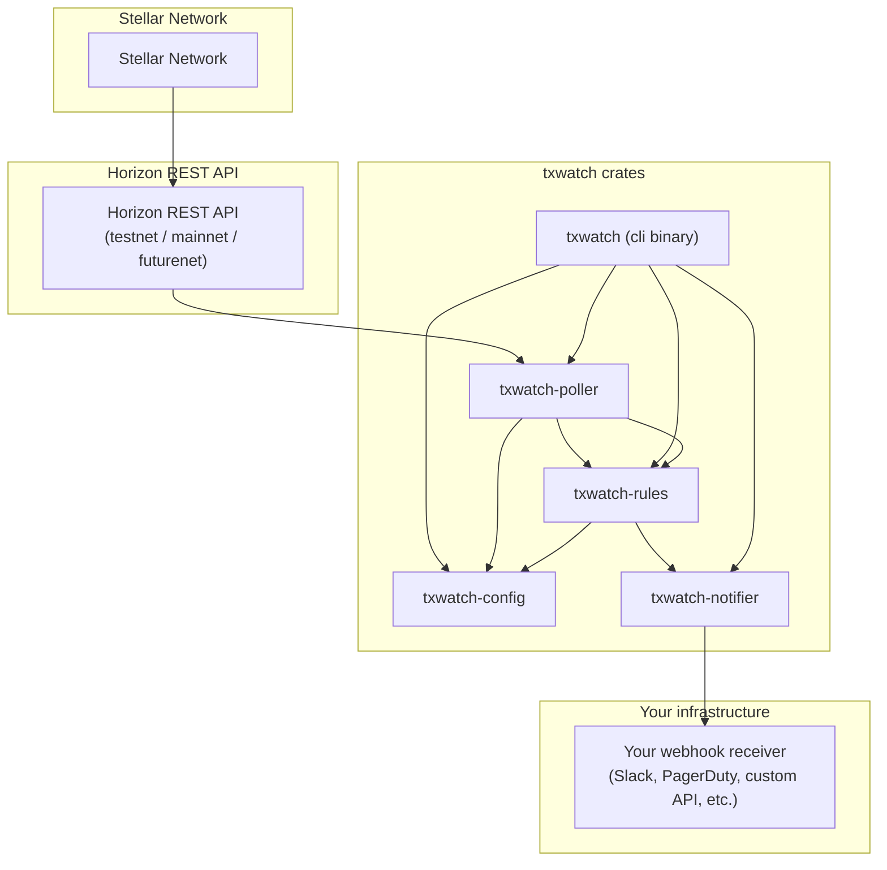

# stellar-txwatch-core

> Real-time Soroban smart contract monitoring and webhook alert engine for the Stellar network.

Part of the [TxWatch](https://github.com/Tx-wat) ecosystem.

---

## What is this?

**TxWatch** sits between the [Stellar Horizon REST API](https://developers.stellar.org/api/horizon)
and your infrastructure. It polls every contract you configure, evaluates alert rules against
each new transaction, and fires a JSON webhook the moment a condition is met — no SDK, no
subscriptions, no infrastructure beyond a single Rust binary.

```
  Stellar Network
       │
       ▼
  Horizon REST API          ← TxWatch polls this
  (testnet / mainnet /
   futurenet)
       │
       ▼
  txwatch-poller            ← fetches /accounts/{contract}/transactions
       │                       fetches /transactions/{hash}/operations
       ▼
  txwatch-rules             ← evaluates AlertRules against each transaction
       │
       ▼
  txwatch-notifier          ← POSTs AlertPayload JSON to your webhook URL
       │
       ▼
  Your webhook receiver     ← Slack, PagerDuty, custom API, etc.
```

### Architecture diagram



---

## Stellar / Soroban primer

| Concept | What it means here |
|---|---|
| **Stellar** | Layer-1 blockchain with fast finality (~5 s) and low fees |
| **Soroban** | Stellar's smart contract platform (WebAssembly-based) |
| **Horizon** | The REST API gateway to the Stellar network — TxWatch's data source |
| **Contract address** | A 56-character string starting with `C` (e.g. `CABC...`) |
| **XLM** | Stellar's native asset; 1 XLM = 10,000,000 stroops |
| **Stroop** | Smallest unit of XLM (like satoshi for Bitcoin) |
| **Paging token** | Horizon cursor used to fetch only new transactions since last poll |
| **invoke_host_function** | The Horizon operation type for a Soroban contract call |

### Horizon endpoints used

| Endpoint | Purpose |
|---|---|
| `GET /accounts/{contract_id}/transactions?cursor=…&order=asc` | Fetch new transactions for a contract |
| `GET /transactions/{hash}/operations` | Fetch operations to extract function name and payment amount |

### Network base URLs

| Network | Horizon base URL |
|---|---|
| Mainnet | `https://horizon.stellar.org` |
| Testnet | `https://horizon-testnet.stellar.org` |
| Futurenet | `https://horizon-futurenet.stellar.org` |

---

## Quickstart

```bash
# 1. Clone
git clone https://github.com/Veritas-Vaults-Network/stellar-txwatch-core
cd stellar-txwatch-core

# 2. Copy and edit the example config
cp config/example.toml config/my-config.toml
$EDITOR config/my-config.toml

# 3. Validate your config
cargo run -p txwatch -- --config config/my-config.toml validate

# 4. Send a test webhook to confirm your receiver works
cargo run -p txwatch -- --config config/my-config.toml \
  test-webhook --url https://hooks.example.com/my-webhook

# 5. Start watching
cargo run -p txwatch -- --config config/my-config.toml watch

# Or run the self-contained minimal quickstart example:
cargo run --example minimal
```

Set `RUST_LOG=debug` for verbose output. This also enables per-contract idle
poll logs — the poller emits `"no new transactions"` debug messages with the
contract label and current cursor when a poll finds nothing new.

### Supported Targets
- `x86_64-unknown-linux-gnu` (default Linux server target)
- `aarch64-unknown-linux-musl` (ARM64 servers, AWS Graviton, Raspberry Pi)

---

## Minimum Supported Rust Version (MSRV)

TxWatch requires **Rust 1.75** or higher (`rust-version = "1.75"`).

---

## Docker

Build the image:

```bash
docker build -t txwatch .
```

Run with a config file:

```bash
docker run -v $(pwd)/config.toml:/config.toml txwatch --config /config.toml watch
```

Or validate your config:

```bash
docker run -v $(pwd)/config.toml:/config.toml txwatch --config /config.toml validate
```

For local development with webhook testing, see [Local Development with Docker Compose](#local-development-with-docker-compose) below.

### Local Development with Docker Compose

The repo ships an example `docker-compose.yml` that runs TxWatch alongside a small
Node.js webhook receiver, so you can watch alerts end-to-end without any external
infrastructure.

```bash
# Start txwatch and the webhook receiver
docker compose up --build
```

The stack contains two services:

| Service | Description | Port |
|---|---|---|
| `txwatch` | Polls Horizon and POSTs alerts to the receiver | — |
| `webhook-receiver` | Node.js example receiver that logs every alert it receives | `3000` (host) → `3000` (container) |

The receiver listens on `http://localhost:3000/webhook` from your host, and TxWatch
is wired to POST to `http://webhook-receiver:3000/webhook` inside the Compose network.
Edit `config/docker-compose.toml` (or the `webhook_url` in your mounted config) if you
want to point TxWatch at a different receiver.

To confirm TxWatch delivers alerts to the receiver:

```bash
# 1. Send a test payload through the same path TxWatch uses
docker compose exec txwatch txwatch --config /config.toml \
  test-webhook --url http://webhook-receiver:3000/webhook

# 2. Check the receiver logs for the delivered payload
docker compose logs -f webhook-receiver
```

You should see the JSON alert payload (including the `X-TxWatch-Idempotency-Key`
and, when a `webhook_secret` is set, `X-TxWatch-Signature` headers) logged by the
receiver. Any alerts triggered by live contract activity will appear in the same
log stream.

---

## CLI

```
txwatch [--config <path>] <command>

Commands:
  watch [--dry-run] [--from-beginning]  Start the polling engine
  validate [--check-webhooks]           Validate the config file and print a summary
  test-webhook --url <URL>              Send a test payload to a webhook URL and exit
```

`--config` defaults to `config/example.toml`. It can also be set with the
`TXWATCH_CONFIG` environment variable; the `--config` flag takes precedence when both are set.

Optional OpenTelemetry trace export: build with `--features opentelemetry` and set
`OTEL_EXPORTER_OTLP_ENDPOINT`. See [docs/configuration.md](docs/configuration.md#opentelemetry-trace-export-optional).

**watch flags:**
- `--dry-run` — evaluate rules and log matches, but do not send any webhooks
- `--from-beginning` — start polling from the earliest available transaction (cursor `0`) instead of `now`. Overrides any persisted `cursor_file` values for this run (does not modify the file). Warning: may generate many alerts for historical transactions.
- `--stream-addr <ADDR>` — enable Server-Sent Events (SSE) streaming on `GET /stream` (e.g. `127.0.0.1:8088`) for local development without public webhooks.
- `--stream-token <TOKEN>` — optional bearer authentication token required to connect to the SSE `/stream` endpoint.

---

### SSE stream format

With `--stream-addr`, `GET /stream` emits one Server-Sent Event per alert. Each event has
the type `alert` and a single `data:` line holding a JSON object. `data` contains the
alert payload (the same JSON as the webhook body) as a string, and `idempotency_key`
(`{contract_id}:{transaction_hash}:{rule_type}`) lets clients deduplicate.

```
event: alert
data: {"idempotency_key":"CAAA...:abc123:LargeTransfer","data":"{\"label\":\"My Escrow Contract\", ...}"}

```

---

## Config

See [docs/configuration.md](docs/configuration.md) for the full reference. For monitoring contracts on Stellar Futurenet, see [docs/futurenet-guide.md](docs/futurenet-guide.md).

### Disabling a contract

Set `enabled = false` on a `[[contracts]]` entry to pause monitoring without deleting it.
Disabled contracts are skipped by the poll loop and logged once at startup. Default: `true`.

### Network configuration

`stellar-txwatch-core` derives the Horizon base URL from each contract's `network`
(`mainnet`, `testnet`, or `futurenet`). To point a single contract at a custom
Horizon endpoint, set the optional per-contract `horizon_url` field — there is no
top-level `rpc_url` key in this repo's config schema.

```toml
[[contracts]]
label       = "My Mainnet Contract"
contract_id = "CAAAAAAAAAAAAAAAAAAAAAAAAAAAAAAAAAAAAAAAAAAAAAAAAAAAAAAA"
network     = "mainnet"
webhook_url = "https://hooks.example.com/my-webhook"
# Optional: override the network-derived Horizon base URL for this contract only.
horizon_url = "https://horizon.stellar.org"
```

> **Note:** Soroban-RPC configuration (e.g. a `SOROBAN_RPC_URLS` map or a
> `rpc_url`/`<API_KEY>` ValidationCloud endpoint) belongs to the sibling
> [stellar-txwatch-web](https://github.com/Veritas-Vaults-Network/stellar-txwatch-web)
> project. `stellar-txwatch-core`'s config file does not accept an `rpc_url` key;
> use `horizon_url` as shown above instead.

```toml
poll_interval_seconds = 10

[[contracts]]
label       = "My Escrow Contract"
contract_id = "CAAAAAAAAAAAAAAAAAAAAAAAAAAAAAAAAAAAAAAAAAAAAAAAAAAAAAAA"
network     = "testnet"
webhook_url = "https://hooks.example.com/my-webhook"

  [[contracts.rules]]
  type          = "LargeTransfer"
  threshold_xlm = 10000

  [[contracts.rules]]
  type           = "AdminFunctionCalled"
  function_names = ["set_admin", "upgrade", "initialize"]

  [[contracts.rules]]
  type = "TransactionFailed"
```

---

## Alert rules

| Rule | Triggers when… |
|---|---|
| `AnyTransaction` | Any transaction touches the contract |
| `TransactionFailed` | A transaction fails (`successful = false`) |
| `LargeTransfer` | Payment amount ≥ `threshold_xlm` XLM, or ≥ `threshold_stroops` stroops (exactly one) |
| `FunctionCalled` | A specific Soroban function is invoked |
| `AdminFunctionCalled` | Any function in a named list is invoked |
| `HighFee` | Transaction fee exceeds configured threshold |

See [docs/alert-rules.md](docs/alert-rules.md) for full details.

---

## Webhook payload

```json
{
  "label":            "My Escrow Contract",
  "contract_id":      "CAAA...",
  "network":          "testnet",
  "rule_type":        "LargeTransfer",
  "rule_triggered":   "LargeTransfer(>=10000XLM)",
  "transaction_hash": "abc123...",
  "function_name":    "transfer",
  "function_names":   ["transfer"],
  "amount_xlm":       15000,
  "amount_stroops":   150000000000,
  "fee_charged_stroops": 50000,
  "operation_count":  2,
  "memo_type":        "text",
  "memo":             "order-1234",
  "timestamp":        1705316096,
  "timestamp_iso":    "2024-01-15T12:00:00Z",
  "horizon_link":     "https://horizon-testnet.stellar.org/transactions/abc123...",
  "explorer_link":    "https://stellar.expert/explorer/testnet/tx/abc123...",
  "ledger_sequence":  12345678,
  "source_account":   "GABC...",
  "tags":             { "team": "payments", "env": "prod" }
}
```

> **Note:** `tags` is optional and is **omitted entirely** from the JSON body when the
> contract has no `tags` configured, so existing receivers are unaffected. When present it
> is a JSON object mapping string keys to string values, copied from the contract's
> `tags` config and useful for routing and filtering in downstream systems.

**Webhook headers:**
- `Content-Type: application/json`
- `Content-Length: <length of JSON body in bytes>`
- `X-TxWatch-Version: <package version>`
- `X-TxWatch-Idempotency-Key: {contract_id}:{transaction_hash}:{rule_type}` (unique key per contract, transaction, and rule)
- `X-TxWatch-Signature: sha256=<hmac>` (optional, only when `webhook_secret` is configured — HMAC-SHA256 of the request body)

> **Security Note:** Webhook receivers must use constant-time comparison (e.g. `hmac.compare_digest` in Python or `crypto.timingSafeEqual` in Node.js) when validating `X-TxWatch-Signature` to protect against timing attacks. Naive equality (`==`) leaks timing information.

**Fields:**
- `rule_type` — stable machine-readable rule variant (e.g. `"LargeTransfer"`, `"HighFee"`); use this for programmatic routing
- `rule_triggered` — human-readable rule description with parameters (e.g. `"LargeTransfer(>=10000XLM)"`); use this for display
- `function_name` — the first invoked Soroban function name, or `null` for non-Soroban transactions.
- `function_names` — all invoked Soroban function names in the transaction (may contain multiple entries for multi-op transactions).
- `operation_count` — total number of operations in the transaction as reported by Horizon, or `null` if not available. Useful for gauging transaction complexity without fetching additional data.
- `memo_type` — the transaction memo type from Horizon (`"text"`, `"hash"`, `"id"`, `"return"` or `"none"`), or `null` if Horizon did not return one.
- `memo` — the transaction memo value (e.g. an order ID or payment reference), or `null` when the transaction has no memo.
- `horizon_link` — direct Horizon REST API URL for the transaction (e.g. `https://horizon-testnet.stellar.org/transactions/<hash>`); useful for fetching raw XDR or operation details programmatically.
- `explorer_link` — Stellar Expert web explorer URL for the transaction (e.g. `https://stellar.expert/explorer/testnet/tx/<hash>`); useful for human-readable inspection in a browser.
- `ledger_sequence` — the Stellar ledger (block) sequence number this transaction was included in; always present when Horizon returns it, otherwise `null`. Use this to cross-reference with Stellar ledger data or detect gaps in monitored activity.
- `source_account` — the Stellar account that signed and submitted the transaction (e.g. `"GABC..."`); always present when Horizon returns it, otherwise `null`. Useful for knowing which user or bot triggered the alert and for filtering alerts by caller in downstream systems.

> **`horizon_link` vs `explorer_link`**: `horizon_link` points to the Horizon REST API endpoint and returns raw JSON — useful for programmatic access. `explorer_link` points to the [Stellar Expert](https://stellar.expert) web UI — useful for human inspection. Both are always present for every alert regardless of rule type.

### Payload changelog

The webhook payload evolves over time. This table records the version in which each field was
introduced so integrators can handle version differences. The payload version is also sent in the
`X-TxWatch-Version` header.

| Field | Introduced in | Notes |
|---|---|---|
| `label` | 0.1.0 | Contract label from config |
| `contract_id` | 0.1.0 | Stellar contract address |
| `network` | 0.1.0 | `testnet`, `mainnet`, or `futurenet` |
| `rule_triggered` | 0.1.0 | Human-readable rule description |
| `transaction_hash` | 0.1.0 | Stellar transaction hash |
| `amount_xlm` | 0.1.0 | Payment amount in XLM, or `null` |
| `amount_stroops` | 0.1.0 | Payment amount in stroops, or `null` |
| `timestamp` | 0.1.0 | Unix timestamp (seconds) |
| `timestamp_iso` | 0.1.0 | ISO-8601 timestamp |
| `function_name` | 0.2.0 | First invoked Soroban function, or `null` |
| `operation_count` | 0.3.0 | Number of operations, or `null` |
| `memo_type` | 0.3.0 | Memo type, or `null` |
| `memo` | 0.3.0 | Memo value, or `null` |
| `ledger_sequence` | 0.3.0 | Ledger sequence number, or `null` |
| `source_account` | 0.3.0 | Source account, or `null` |
| `rule_type` | 0.4.0 | Stable machine-readable rule variant |
| `function_names` | 0.4.0 | All invoked Soroban function names |
| `horizon_link` | 0.4.0 | Horizon REST API URL for the transaction |
| `explorer_link` | 0.4.0 | Stellar Expert explorer URL for the transaction |
| `fee_charged_stroops` | 0.5.0 | Fee charged for the transaction, in stroops |

**Compatibility policy:**

- **New optional fields** are added in minor releases without breaking changes. Receivers must
  tolerate unknown fields and treat newly added fields as optional (they may be absent in payloads
  from older versions).
- **Removed or renamed fields** require a **major version bump**. Receivers should not rely on a
  field being present unless it is documented as always present.
- Existing fields keep their meaning and type across minor releases.

---

## Verifying webhook signatures

When `webhook_secret` is configured, TxWatch sends an `X-TxWatch-Signature` header of the form
`sha256=<hmac>`. The signature is computed as:

```
hex(HMAC-SHA256(body_bytes, secret))
```

where `body_bytes` is the **raw JSON request body exactly as sent on the wire** — the signature
covers the raw bytes, **not** a canonicalized or re-serialized form. Do not parse and re-encode the
JSON before verifying, as that will change the bytes and invalidate the signature. Compare the
computed hex digest against the value after `sha256=` using a **constant-time comparison**.

### Node.js

```js
const crypto = require("crypto");

function verifyTxWatchSignature(rawBody, secret, signatureHeader) {
  // rawBody must be the raw request body as a Buffer or string, not parsed JSON.
  const expected =
    "sha256=" +
    crypto.createHmac("sha256", secret).update(rawBody).digest("hex");

  const a = Buffer.from(expected);
  const b = Buffer.from(signatureHeader || "");
  if (a.length !== b.length) return false;
  return crypto.timingSafeEqual(a, b);
}

// Express example (must use a raw body parser for this route):
// app.post("/webhook", express.raw({ type: "application/json" }), (req, res) => {
//   const ok = verifyTxWatchSignature(req.body, process.env.TXWATCH_SECRET, req.get("X-TxWatch-Signature"));
//   if (!ok) return res.status(401).send("invalid signature");
//   const payload = JSON.parse(req.body.toString("utf8"));
//   res.sendStatus(200);
// });
```

### Python

```python
import hashlib
import hmac

def verify_txwatch_signature(raw_body: bytes, secret: str, signature_header: str) -> bool:
    # raw_body must be the raw request body bytes, not parsed JSON.
    expected = "sha256=" + hmac.new(
        secret.encode("utf-8"), raw_body, hashlib.sha256
    ).hexdigest()
    return hmac.compare_digest(expected, signature_header or "")

# Flask example:
# @app.post("/webhook")
# def webhook():
#     raw_body = request.get_data()  # raw bytes
#     if not verify_txwatch_signature(raw_body, os.environ["TXWATCH_SECRET"],
#                                     request.headers.get("X-TxWatch-Signature")):
#         return "invalid signature", 401
#     payload = json.loads(raw_body)
#     return "", 200
```

### Go

```go
package main

import (
	"crypto/hmac"
	"crypto/sha256"
	"encoding/hex"
	"strings"
)

func verifyTxWatchSignature(rawBody []byte, secret, signatureHeader string) bool {
	// rawBody must be the raw request body bytes, not a decoded struct.
	mac := hmac.New(sha256.New, []byte(secret))
	mac.Write(rawBody)
	expected := "sha256=" + hex.EncodeToString(mac.Sum(nil))
	return hmac.Equal([]byte(expected), []byte(signatureHeader))
}

// net/http example:
// func webhook(w http.ResponseWriter, r *http.Request) {
//     rawBody, _ := io.ReadAll(r.Body)
//     if !verifyTxWatchSignature(rawBody, os.Getenv("TXWATCH_SECRET"),
//         r.Header.Get("X-TxWatch-Signature")) {
//         http.Error(w, "invalid signature", http.StatusUnauthorized)
//         return
//     }
//     // ... handle rawBody ...
// }
```

---

## Architecture

```
txwatch (cli binary)
  │
  ├── txwatch-config      TOML parsing · contract ID validation · rule validation
  │
  └── txwatch-poller      Horizon polling loop · cursor tracking · op enrichment
        │
        ├── txwatch-rules     AlertRule evaluation · AlertPayload construction
        │
        └── txwatch-notifier  Webhook POST · 3-attempt exponential backoff · tracing logs
```

### Crate responsibilities

| Crate | Responsibility |
|---|---|
| `txwatch-config` | Parse `config.toml` into typed structs; validate all fields |
| `txwatch-rules` | Pure rule evaluation — no I/O, fully unit-testable |
| `txwatch-notifier` | HTTP webhook delivery with retry; timestamped structured logs |
| `txwatch-poller` | Horizon REST client; cursor map; per-transaction error isolation |
| `txwatch` (cli) | `clap` binary; tracing init; subcommand dispatch |

---

## Tracing and observability

TxWatch uses `tracing` spans to correlate work across each poll cycle and webhook delivery.
- `txwatch-poller::poll_contract` is instrumented with `contract`, `contract_id`, and `network` fields.
- `txwatch-poller::fetch_soroban_details` is instrumented with the transaction hash.
- `txwatch-notifier::send_webhook` creates a span with `contract` and `rule` fields before sending the webhook request.

Set `RUST_LOG=info` or a more specific filter to view structured tracing output in the CLI.

### Prometheus metrics (optional)

Build with the `metrics` feature to expose Prometheus counters and an HTTP `/metrics` endpoint:

```bash
cargo build -p txwatch-poller --features metrics
```

Metrics registered:

| Counter | Description |
|---|---|
| `txwatch_transactions_total` | Total Stellar transactions processed across all watched contracts |
| `txwatch_alerts_total` | Total alert payloads sent (rules matched) |
| `txwatch_webhook_failures_total` | Total permanent webhook delivery failures (after all retries) |
| `txwatch_enrichment_errors_total` | Transactions skipped because enrichment failed (e.g. an unparseable `created_at`). The cursor still advances past them, so they are not retried. |
| `txwatch_config_reload_total` | Total config loads and reloads (starts at 1 at startup; hot-reload support #227) |

To start the `/metrics` endpoint, call `txwatch_poller::serve_metrics(addr)` before `run_with`.
The endpoint serves the standard Prometheus text exposition format and can be scraped by any
Prometheus-compatible monitoring stack (Prometheus, Grafana Agent, VictoriaMetrics, etc.).

Example scrape config:

```yaml
scrape_configs:
  - job_name: txwatch
    static_configs:
      - targets: ['localhost:9090']
```

---

## How a transaction flows through TxWatch

```
1. Poller wakes up (every poll_interval_seconds)
2. For each contract:
   a. GET /accounts/{contract_id}/transactions?cursor={last_seen}&order=asc
      → on 410 Gone (cursor expired): log a warning, reset cursor to "now", skip this cycle
   b. For each new transaction:
      i.  Advance cursor (even if enrichment fails)
      ii. GET /transactions/{hash}/operations
          → extract function_name from invoke_host_function ops
          → extract amount_stroops from payment ops
      iii. Build EnrichedTransaction
      iv.  Evaluate all AlertRules → Vec<AlertPayload>
      v.   POST each AlertPayload to webhook_url (retry up to 3×)
```

### Log Sampling for Idle Poll Cycles
To prevent noisy log output during extended idle periods, TxWatch samples `debug!` log emissions for contracts with no new transactions: the first idle cycle logs immediately, and subsequent consecutive idle cycles log once every 60 cycles (or upon new transactions).

---

## Stellar testnet resources

| Resource | URL |
|---|---|
| Testnet Horizon | https://horizon-testnet.stellar.org |
| Stellar Expert (testnet) | https://stellar.expert/explorer/testnet |
| Stellar Laboratory | https://laboratory.stellar.org |
| Friendbot (fund testnet accounts) | https://friendbot.stellar.org |
| Soroban docs | https://developers.stellar.org/docs/smart-contracts |

---

## Sister repos

| Repo | Description |
|---|---|
| [stellar-txwatch-web](https://github.com/Veritas-Vaults-Network/stellar-txwatch-web) | Web dashboard for alert history and contract management |
| [stellar-txwatch-contracts](https://github.com/Veritas-Vaults-Network/stellar-txwatch-contracts) | Example Soroban contracts to monitor with TxWatch |

---

## Contributing

See [CONTRIBUTING.md](CONTRIBUTING.md).

## Security

Please do **not** open a public issue for security vulnerabilities. See
[SECURITY.md](SECURITY.md) for supported versions, the responsible-disclosure
process, and expected response timelines.

## License

MIT

## Handsoff notes

<!-- handsoff-issue-336 -->
- #336: bug: rejects_poll_interval_too_low test creates AppConfig without cursor_file field — compilation error

<!-- handsoff-issue-576 -->
- #576: test: add test for format_xlm helper function
